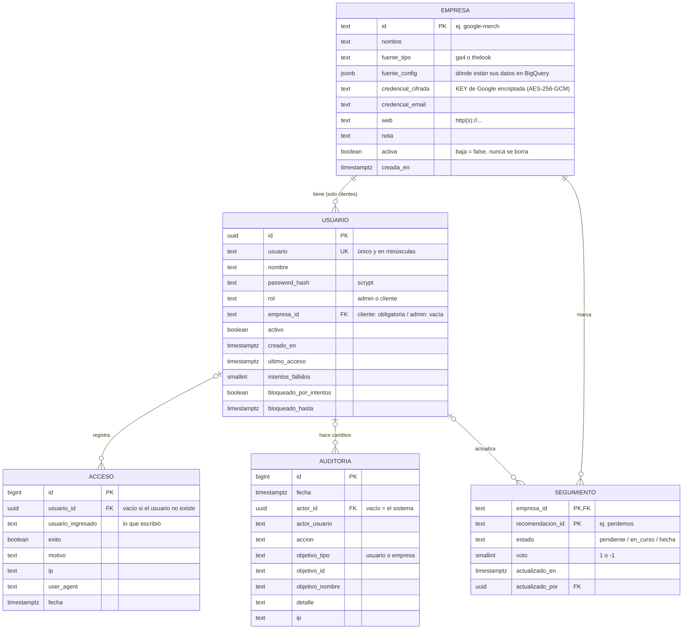

# MER de Returnly

Modelo Entidad-Relación de la base de datos de Returnly (PostgreSQL en Supabase), tal como está hoy.
La versión completa y explicada en simple está en **[MER-Returnly.pdf](MER-Returnly.pdf)** (9 páginas).
El PDF se genera desde [MER-fuente.html](MER-fuente.html).

## Relaciones

| Relación | Tipo | Enlace | ¿Puede quedar vacío? |
|---|---|---|---|
| EMPRESA tiene USUARIOS | 1 a N | `usuario.empresa_id` | Solo para admins (la base obliga a que todo cliente tenga empresa) |
| USUARIO registra ACCESOS | 1 a N | `acceso.usuario_id` | Sí, si se escribió un usuario que no existe |
| USUARIO hace CAMBIOS | 1 a N | `auditoria.actor_id` | Sí, si lo hizo el sistema (bloqueo automático) |
| EMPRESA marca SEGUIMIENTO | 1 a N | `seguimiento.empresa_id` | No (parte de la clave) |
| USUARIO actualiza SEGUIMIENTO | 1 a N | `seguimiento.actualizado_por` | Sí |
| AUDITORIA es sobre un USUARIO o una EMPRESA | N a 1 | `objetivo_tipo` + `objetivo_id` | Sin enlace fijo (puede ser de dos tablas) |

Todas las tablas tienen RLS activado sin políticas: solo el backend (con la clave secreta) puede leerlas y escribirlas.
